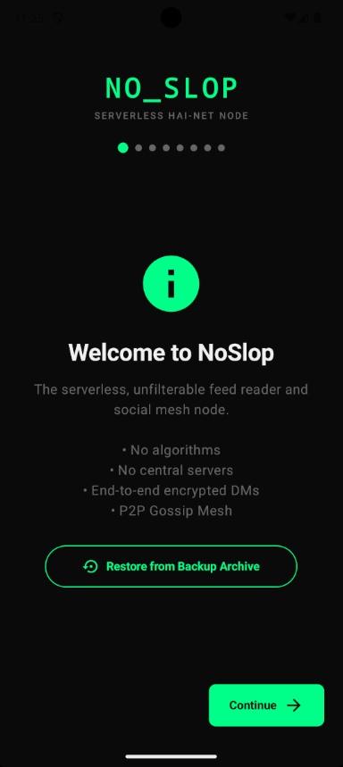
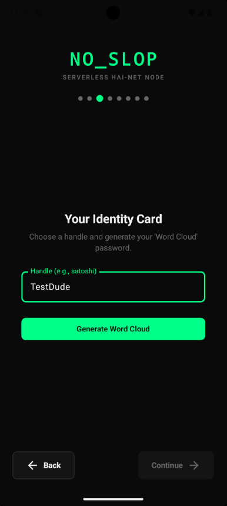
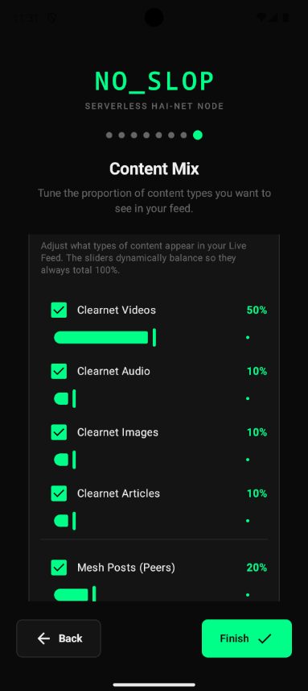
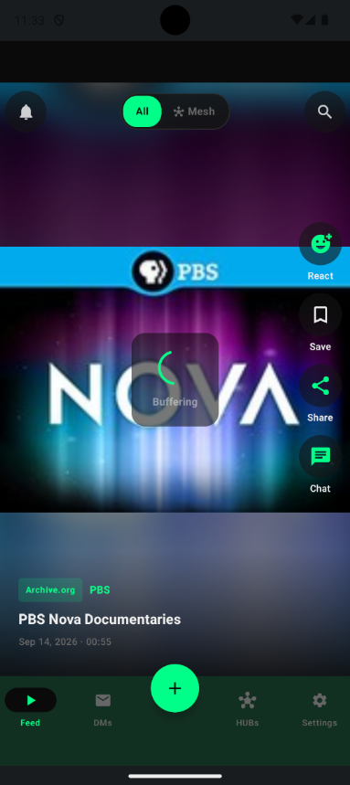
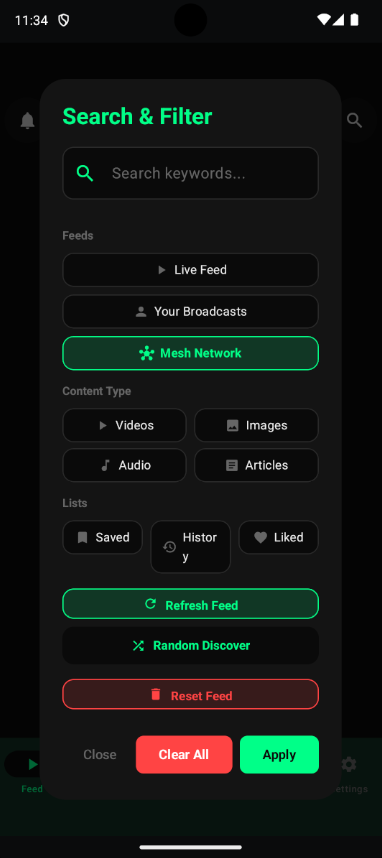
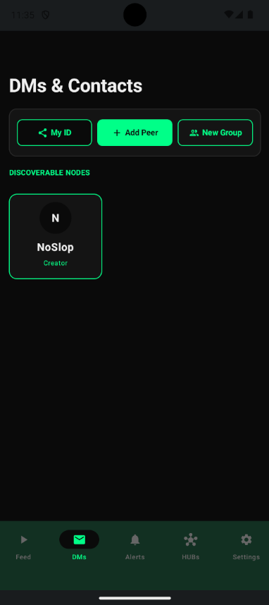
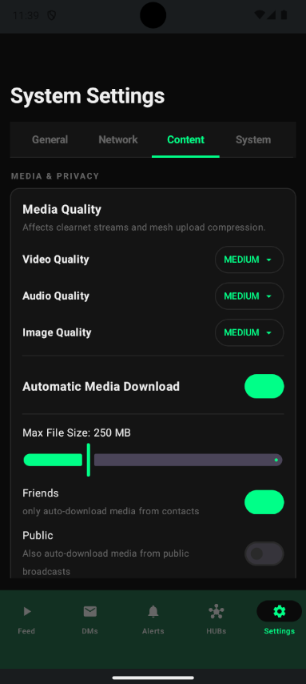
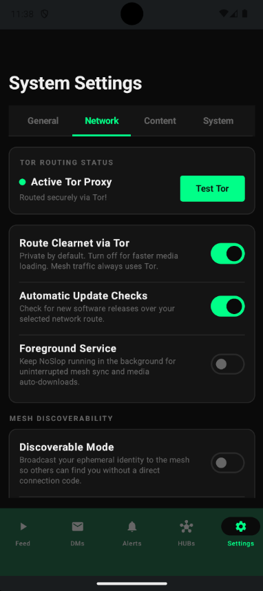

# 🚫 NoSlop — The Unfiltered Pulse of the Mesh 🕸️

  <em>"Your feed. Your identity. Zero algorithms. 100% freedom."</em>

  
  
  
  

---

## 💡 What is NoSlop?

**NoSlop** is a sovereign, privacy-first Android app for **peer-to-peer chat and social sharing over [Tor](https://www.torproject.org/)**: end-to-end encrypted direct messages and group chats, friends-only sharing, and public broadcasts from creators on the mesh. Tor relays carry the traffic, but no server holds your identity, your data or your choices. Alongside it, a built-in, tracker-free **clearnet aggregator** lets you read the open web in the same app, with no algorithm, and bring what you find to your friends over the mesh.

There are **no accounts**, **no emails**, **no phone numbers**, and **zero algorithmic slop**. Your identity is an Ed25519/X25519 cryptographic keypair generated on your device. Chatting and connecting with friends or creators happens directly through peer-to-peer Tor hidden services (`.onion`).

**The mesh is the point, and the aggregator is a way into it.** Chat, group chat, friends-only sharing and creator broadcasts are what NoSlop is for, and the mesh is where I hope the content people care about will live: a direct, unaltered link between creator and reader, controlled by both. The aggregator is built in because I wanted to read the open web without other apps and without trackers, and it gives a new install, or a small circle of friends, something worth opening on day one. As more creators join, I expect the mesh to carry more of the feed, and the aggregator may then be off by default and stay for public open sources. You can switch it off at any time.

> 📖 **Deep Technical Details:** All cryptographic derivations, transport architectures, and protocol specifications live in [docs/TECHNICAL_REFERENCE.md](docs/TECHNICAL_REFERENCE.md) and [docs/WIRE_PROTOCOL_REFERENCE.md](docs/WIRE_PROTOCOL_REFERENCE.md).

---

<!-- screenshots:start -->
## 📸 Screenshots

<table>
<tr><td align="center"> Welcome</td><td align="center"> Identity</td><td align="center"> Content mix</td><td align="center"> Feed</td></tr>
<tr><td align="center"> Search filters</td><td align="center"> Direct messages</td><td align="center"> Content settings</td><td align="center"> Network settings</td></tr>
</table>
<!-- screenshots:end -->

---

## ⚡ Why Stop the Slop?

* 🕸️ **Peer-to-Peer Over Tor** — Chat and share directly between phones across Tor hidden services, with multi-hop gossip relay. No accounts, and no server holds your identity, your data or your choices.
* 📬 **Private Chat & Group Chat** — E2EE Direct Messages (v2 directional X25519 + ChaCha20-Poly1305 AEAD with AAD metadata binding and delivery ACKs) and pairwise encrypted group chats.
* 👥 **Friends-Only Sharing & Public Broadcasts** — Share with the people you know, or publish public broadcasts to the mesh from a separate, burnable creator identity.
* 🧅 **Tor-Routed Anonymity** — Default network traffic routes through an embedded Tor daemon with per-stream circuit isolation. Article WebViews and external browser links are gated with explicit Tor leak warnings.
* 📰 **A Built-in Clearnet Aggregator** — Read the open web inside NoSlop with no trackers and no algorithm. You choose your mix quotas, sources and categories (with an optional Random Discover mode), requests go over Tor by default like the mesh, and you can switch it off. Liking, commenting or sharing clearnet content brings that conversation onto the mesh.
* 🎧 **Background Playback Out-of-the-Box** — Stream videos and audio seamlessly while browsing other tabs or with your screen locked. A video that stalls recovers in place, at the same position, whether you're watching or away.
* 🚫 **100% Ad & Tracker-Free** — Pure tracker-free client (using offline ZXing barcode scanning, no Google telemetry SDKs). Zero banners or sponsored interruptions.
* 🧘 **Mindful Exit & Break Reminders** — Gentle, scheduled prompts to step away from your device under complete user control with zero engagement-trap dark patterns.
* 🌍 **Global Multi-Language Accessibility** — 21+ languages natively supported out-of-the-box with zero-code dynamic translation discovery (800+ UI strings; a test enforces that every string has an English entry, and untranslated strings fall back to English).

---

## ✨ Core Features

### 🕸️ Decentralized Social Mesh (HAI-Net)

**This is the heart of NoSlop.** Direct peer-to-peer communication over the HAI-Net gossip network. Tor relays carry the traffic, and no server holds your identity, your data or your choices (fresh nodes bootstrap discoverability with an optional untrusted Official Creator Node):

* 📬 **End-to-End Encrypted DMs** — Secure messaging via directional X25519 key agreement and ChaCha20-Poly1305 AEAD (v2) with AAD binding and delivery acknowledgments.
* 👥 **Decentralized Group Chats** — End-to-end encrypted multi-member group conversations with pairwise X25519 fan-out, persistent store-and-forward outbox, audience controls (`🌐 All Members` vs `👥 Friends Only`), non-admin invites, and admin moderation.
* 🤝 **Friends-Only Sharing** — Post to the people you've connected with. Friends-only posts stay with your personal identity, while public broadcasts go out under a separate creator identity.
* 🎬 **Creator Studio & Severable ID** — Dedicated Creator Mode equipped with an ephemeral/burnable secondary identity (`.onion`). Creators can share their **Creator ID 🪪**, receive followers, and publish public broadcasts under a separate key and onion address; friends-only posts stay with the personal identity. The creator identity shows your profile unless you set a different name, bio or picture on the Studio page. Back it up to a passphrase-protected file, and import or restore it on another node with its followers, posts and media. Creator contacts are never sent the personal key or onion address. Reactions and votes on a creator post are made by the creator identity, and "Share Permanent Identity" in a temporary chat asks from your personal identity. A linked Hub relays on its own terms.
* 🏠 **Home HUBs & Admin AI (in development)** — The app can link or auto-deploy an always-on home server over SSH as a master database and private LLM assistant, but the Hub side is still being built and no Hub is deployed yet. Treat this as experimental. It is built in only with `NOSLOP_ENABLE_HUB=true` (see [docs/BUILD.md](docs/BUILD.md)).
* 🌉 **Clearnet-to-Mesh Bridge** — Liking, commenting, or sharing clearnet content instantly transforms it into a signed, deterministic SHA3-256 mesh anchor post. This is how conversation about clearnet content moves onto the mesh.
* 🛡️ **Gossip Firewall & Mesh Filters** — 6-hop flood routing with LRU deduplication, packet verification, and granular toggles for incoming and outgoing media types.
* ✍️ **Every Packet Signed** — Each packet carries an Ed25519 envelope signature by its sender, so nobody can pose as one of your contacts. Unsigned, forged, replayed or badly out-of-date packets are dropped, so device clocks must be within an hour. Versions before v0.7.0-alpha can't connect to this one: both sides must update.

---

### 🔑 Sovereign Cryptographic Identity

* 🔐 **Ed25519 + X25519 Keys** — Generated locally using Bouncy Castle pure lightweight cryptographic engine.
* 🧅 **Native Tor v3 Onion Address** — Your node address is derived directly from your public key for direct peer reachability.
* 🪪 **Dual-Identity Separation** — Primary identity for trusted personal contacts; severable burnable identity for public creator broadcasts and for following discovered creators. One router picks the identity for every packet.
* ☁️ **Word Cloud Backup** — 12-word recovery mnemonic, and a backup encrypted with AES-256-GCM in authenticated chunks, under its own key derived from the Word Cloud. It's encrypted as it's written and decrypted as it's read, so no unencrypted copy ever touches the disk, and a damaged or altered file is refused before anything changes. Older backups still restore.
* 🪪 **Verified in Person** — 8-character tags (Argon2id) after every name, and a check code on every ID card. Scan a friend's QR code with your camera, they approve after comparing name and check code, and you both show as verified in person. Codes from pictures or pasted IDs come with a warning, and so do new contacts whose name you already know. If a contact's encryption key changes, it's applied and the chat says so.

---

### 🧅 Tor-Routed Networking

* 🛡️ **Default Tor Routing** — Outbound feed fetches, media streams, API requests, and mesh packets route through an embedded local Tor daemon.
* 🔄 **SOCKS5 Stream Isolation** — Per-stream Tor isolation (`IsolateSOCKSAuth`) assigns separate circuits to distinct media streams. That keeps each stream on the same exit and reduces Google IP-lock stalls.
* 🔁 **Graceful Exit Hopping** — Nonce-bumping hops Tor exits upon provider blocks without process-wide circuit disruption.
* 📲 **Peerless OTA Updates** — Background update checking over Tor. The GitHub build verifies the SHA-256 checksum and signing certificate, then saves the update to your Download folder for you to install.

---

### 📱 The Feed and the Clearnet Aggregator

A vertically snapping feed purpose-built for clean signal-to-noise ratio. Its clearnet content comes from the built-in aggregator:

* 🎬 **Universal Media Playback** — Native audio & video streaming (HLS, MP4, WebM, MP3, Archive.org, and direct streams) with Tor preloading that warms up to three slides ahead, so the next video is usually already playing when you swipe.
* 🖥️ **Immersive Landscape Mode** — Rotate your device horizontally to automatically hide navigation and overlays for edge-to-edge viewing.
* 📖 **Segmented Article Reader** — Multi-page horizontal book-style reader with asynchronous OpenGraph lead image resolution and full Markdown support.
* 🎛️ **Non-Algorithmic Interleaved Curation** — Balanced mix quotas interleaving favorite creators, selected topics, and discovery items without opaque recommendation algorithms.
* 🏷️ **3-Tier Nuanced Reactions** — 20 expressive reactions categorized into **Positive** (❤️ 👍 😂 🔥 😮 🎉 💡 👏 💎), **Expressive** (😢 😡 😱 🤔 🤯 🧘), and **Negative** (👎 💩 🤮 🤡 🚫).
* 🚫 **1-Tap Channel Banning** — React with 🚫 to immediately blacklist content creators and purge their slides from your feed.
* 📅 **Content Farm Cut-Off Filter** — Exclude automated channels created after a set date (e.g. drop post-2022 AI content farms).
* 🔖 **Saved & History Feeds** — Bookmark items with 1 tap; browse your full chronological history with instant full-text search.
* 🔎 **Search That Keeps Going** — Results depend only on your search terms and filters. They're listed newest first and keep loading as you swipe. Blocked creators, banned channels and nodes, and anything you voted down stay hidden.
* 🧘 **Mindful Exit & Break Reminders** — User-controlled wellbeing prompts injected at customizable intervals (time spent or slide count) with 1-tap exit and continue controls.

---

## 🌍 Community Localization (21+ Languages Supported)

NoSlop is designed to be accessible to anyone, anywhere in the world. As of **v0.5.8-alpha**, the app includes **21 native language translations** of the UI, modals and system messages. Any string not yet translated falls back to English:

| Language | Code | Native Name | Language | Code | Native Name |
|---|---|---|---|---|---|
| English | `en` | English | العربية | `ar` | Arabic |
| Magyar | `hu` | Hungarian | Nederlands | `nl` | Dutch |
| Español | `es` | Spanish | Polski | `pl` | Polish |
| Deutsch | `de` | German | Türkçe | `tr` | Turkish |
| Italiano | `it` | Italian | Українська | `uk` | Ukrainian |
| Português | `pt` | Portuguese | Čeština | `cs` | Czech |
| Français | `fr` | French | Svenska | `sv` | Swedish |
| Русский | `ru` | Russian | Română | `ro` | Romanian |
| 中文 | `zh` | Chinese (Simplified) | Tiếng Việt | `vi` | Vietnamese |
| 日本語 | `ja` | Japanese | हिन्दी | `hi` | Hindi |
| 한국어 | `ko` | Korean | | | |

### 🗣️ Help Review & Submit Translations!
Are you a native speaker of one of the languages above? **We warmly invite you to review existing strings, report typos, or improve natural phrasing!**

NoSlop features **Zero-Code Dynamic Language Discovery**:
- Anyone can contribute a translation without knowing Kotlin or writing code.
- Simply inspect or duplicate `app/src/main/assets/languages/content_en.json` and translate the text on the right side of each key.
- Dropping a new `content_<code >.json` file into the assets folder immediately registers it in the app's language selector at runtime!
- Read our step-by-step [docs/TRANSLATION_GUIDE.md](docs/TRANSLATION_GUIDE.md) to get started or submit a Pull Request.

---

## 🛠️ Tech Stack

| Layer | Technologies |
|---|---|
| **UI** | Jetpack Compose (Material Design 3), Compose Animation, Markdown Spans |
| **Media** | Media3 / ExoPlayer, Coil, Android System WebView (fallback) |
| **Networking** | Embedded Tor daemon (`tor-android`), OkHttp, SOCKS5 Stream Isolation |
| **Cryptography** | Ed25519 (Bouncy Castle), X25519, ChaCha20-Poly1305, SHA3-256, AES-256-GCM |
| **Persistence** | Room (SQLite; Keystore AES-256-GCM group message encryption at rest; database files protected by Android file-based encryption), EncryptedSharedPreferences (Android Keystore). Fallback: AES-GCM under a separate Keystore key, or, with no working Keystore, under a device-derived key that only obscures; the app warns |
| **Hardware** | CameraX (QR scanning & media capture), ZXing (tracker-free) |
| **Background** | Android WorkManager & Foreground Services |

---

## 🤖 How NoSlop Is Built

NoSlop is written with heavy help from several leading large language models (LLMs). I can't afford to hire developers, and in my experience these models write better code than many I could hire if I could, so I use them. For now I direct the work and test every release myself, on real devices. I've made it all open source in the hope that qualified developers will read it, check it and improve it.

Releases are tested to the best of my ability, which is why they are marked **alpha**, and NoSlop stays alpha until it gets enough contributions from qualified developers. If you are one, start with [CONTRIBUTING.md](CONTRIBUTING.md). Review of the cryptography, the protocol and the Android code is the most valuable help there is.

---

## ⚠️ Alpha Status & Known Limitations

NoSlop is early software. Please read this before you rely on it:

* **Alpha, Android first.** Expect rough edges. Releases are tested to the best of my ability, on many devices, but they stay marked alpha until qualified developers have contributed enough to the project. An iOS and desktop port is in progress under `mvp/`.
* **Sideloaded.** There is no store listing: install the APK from the GitHub releases page and verify its SHA-256 checksum.
* **The clearnet aggregator depends on outside sites.** It reads public feeds and APIs, including YouTube's unofficial interface, which can change or block it without notice, and the terms of some sources are still unchecked. More sources are welcome from the community.
* **Both sides must update.** Versions before v0.7.0-alpha can't talk to current ones, and device clocks must agree to within an hour.
* **DMs have no forward secrecy yet.** They use static X25519 keys. A Double Ratchet is planned, not started.
* **The database is only partly encrypted.** DM and group message bodies are; feed items, history, peers and settings rely on Android's file encryption. Photos, videos and audio you send or receive are ordinary files in the app's own storage folder.
* **Some requests pass through servers I run.** Search requests for YouTube, Reddit and Jamendo go through a Cloudflare Worker (source in [`proxy/`](proxy/)), which sees the search terms but, over Tor, not who sent them. Settings › Report an Issue goes through a relay at noslop.me and becomes a public GitHub issue. See the [FAQ](docs/FAQ.md).
* **Updates are checked, not authenticated.** The app verifies the APK's checksum and signing certificate, with no extra signature and no certificate pinning on the check.
* **Never reviewed by a professional.** NoSlop uses standard cryptographic primitives, but the protocol built from them is its own, and no human professional has ever reviewed it. Read the [FAQ](docs/FAQ.md) before you trust it with anything sensitive.
* **Back up your Word Cloud.** No server holds a copy of your identity, so there is no recovery.
* **Only connect with people you know.** NoSlop has no central moderation. Anyone can run a discoverable creator node and publish anything, so treat creators you find as strangers: the app follows them with your secondary, burnable identity, not your permanent one. Keep your permanent identity for people you know. If a child uses NoSlop, a trusted adult should set it up and make sure they only connect with people they know.

The full list of open work is in [docs/PROJECT_STATUS.md](docs/PROJECT_STATUS.md). To report a security problem, see [SECURITY.md](SECURITY.md).

---

## 🚀 Getting Started

1. **Build from source** — Follow the step-by-step compilation guide in [docs/BUILD.md](docs/BUILD.md).
2. **Complete Onboarding** — Set your language, record your 12-word Word Cloud mnemonic, then choose the topics and creators for the built-in clearnet aggregator and tune your content mix.
3. **Connect with People You Know** — Scan or share a Contact Card QR code in person to start chatting and sharing with friends and family. Follow creators by their Creator ID as they join the mesh.

---

## 📚 Documentation Index

* 🏗️ **[docs/BUILD.md](docs/BUILD.md)** — Compilation instructions, signing configuration, and releasing an update.
* 📡 **[docs/WIRE_PROTOCOL_REFERENCE.md](docs/WIRE_PROTOCOL_REFERENCE.md)** — Complete 24-packet HAI-Net wire protocol catalog and payload schemas.
* 🔬 **[docs/TECHNICAL_REFERENCE.md](docs/TECHNICAL_REFERENCE.md)** — Deep technical specification (crypto derivations, Tor internals, SOCKS5 isolation, media pipelines).
* 🌍 **[docs/TRANSLATION_GUIDE.md](docs/TRANSLATION_GUIDE.md)** — Guide for community localization and language JSON files.
* 🛡️ **[docs/PRIVACY_POLICY.md](docs/PRIVACY_POLICY.md)** — User privacy expectations, data sovereignty, and security posture.
* 🔐 **[SECURITY.md](SECURITY.md)** — How to report a vulnerability privately, what is in scope, and the known limitations.
* 🤝 **[CONTRIBUTING.md](CONTRIBUTING.md)** — Translations, bug reports and code changes: how to help and the project's rules.
* ❓ **[docs/FAQ.md](docs/FAQ.md)** — Straight answers: how NoSlop compares to Briar and SimpleX, which servers are involved, safety, Tor speed, and how it is built.
* 🧭 **[docs/NoSlop-Discovery-Mirroring-Home-HUB-Enhancement-Plan.md](docs/NoSlop-Discovery-Mirroring-Home-HUB-Enhancement-Plan.md)** — Proposed creator discovery, community mirroring and Home HUB work (not implemented).
* 📱 **[docs/migration/](docs/migration/README.md)** — The iOS and desktop port in `mvp/`.
* 🏠 **[docs/archived/HUB_INTEGRATION_PLAN.md](docs/archived/HUB_INTEGRATION_PLAN.md)** — HAI-Net Home Hub integration blueprint and roadmap.
* 📈 **[docs/PROJECT_STATUS.md](docs/PROJECT_STATUS.md)** — Current status, all remaining work, recent changes and the findings matrix (single source of truth). Older entries are in `docs/archived/PROJECT_STATUS_HISTORY.md`.
* 🗄️ **[docs/archived/](docs/archived/)** — Historical architectural proposals, milestone verification reports, and legacy roadmaps.
* 🛠️ **[docs/SUPPORT.md](docs/SUPPORT.md)** — Backup/restore guides, troubleshooting, and extracting diagnostic logs.

---

## ⚖️ User Responsibilities

* 📦 **Decentralized, No Central Servers** — No server holds your identity, your data or your feed choices, and there is no corporate account or cloud backup. Tor relays carry the traffic between peers, and the Official Creator Node is optional and untrusted. Always back up your 12-word Word Cloud.
* 🤝 **Bring Your Own Network** — NoSlop does not maintain public user directories. Direct peer connections are formed deliberately by exchanging QR codes or onion addresses.
* 📲 **Direct Installation** — Because NoSlop bypasses centralized app stores, you must allow installation of unknown apps on Android.

---

## 💖 Support the Vision

NoSlop is 100% free, open-source, tracker-free, and advertisement-free. If you find value in sovereign communication with no central servers, consider supporting independent development:

🪙 ☕ 🍱 **[Toss me a coin or buy me a meal](https://donate.stripe.com/dRmfZae1F0jNfPNfFC9fW00)**

---

## 🌐 About

NoSlop is part of the **[HAI-Net Initiative](https://hai-net.com)** — building open networks where tools serve people, not corporate algorithms.

Licensed under **[AGPL-3.0](LICENSE.md)**. Fork it. Run it. Own it.

  ✨ <em><a href="https://gaborkukucska.com">Dreamed up by Gabby</a></em>

